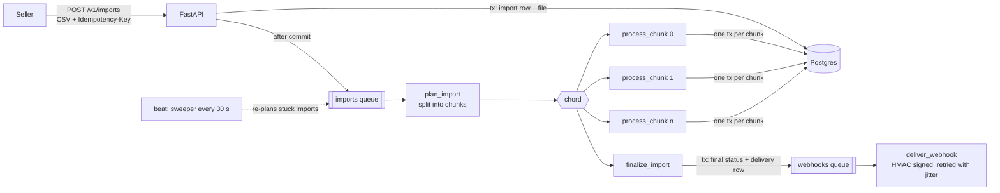

# fastapi-celery-imports

Bulk catalog import for a marketplace. Sellers upload CSV files with tens of thousands of products, prices and stock levels. The stack is **FastAPI**, **Celery 5.6 on RabbitMQ quorum queues**, **PostgreSQL** and Redis (for chord results).

Files are split into chunks that are validated and upserted in parallel. Invalid rows are reported with their exact line number. The seller is notified with a signed webhook.

The focus is the part that is hard to get right: background jobs that are neither **lost nor applied twice** when workers die, the broker restarts, or tasks are retried.

## Try it in 2 minutes

**You need:** Docker with Compose v2, and `make`. Python, uv and the demo all run in containers.

```bash
git clone https://github.com/msalimcengiz/fastapi-celery-imports && cd fastapi-celery-imports
make demo               # starts the stack and walks through 9 checked steps (below)
make test               # 16 unit tests
make test-integration   # 11 integration tests against the running stack
make lint               # ruff + mypy --strict
make bench              # rows/s for 2M rows with 1, 2 and 4 import workers (~3 min)
make chaos              # imports keep arriving while workers and RabbitMQ are SIGKILLed
make down
```

`make demo` prints each step and fails if something does not behave as described:

1. A 5,000-row CSV with Turkish decimal commas and 1% bad rows is imported in parallel chunks: 4,950 rows imported, 50 rejected.
2. The rejected rows are listed with their exact line number in the file and the reason.
3. The seller's endpoint, a demo receiver container, gets the webhook and verifies its HMAC signature.
4. The same `Idempotency-Key` returns the same import, and the same key with a different file is refused with `409`.
5. Another seller gets `404`, and a request without an API key gets `401`.
6. The receiver answers `503` twice: the webhook is retried with jittered backoff and delivered on attempt 3, with the same `X-Delivery-Id` each time.
7. A 200,000-row import starts, and **every import worker is killed with SIGKILL** while it runs.
8. The workers restart, unacknowledged chunks are redelivered, and the result is exactly 198,000 + 2,000 rows.
9. A running import is cancelled, and its remaining chunks are skipped.

To explore by hand: interactive API docs at http://localhost:8001/docs, or [`requests.http`](requests.http).

| Port | Service |
|---|---|
| 8001 | API (`/docs` for OpenAPI) |
| 9000 | Demo webhook receiver (`GET /received`) |
| 15673 | RabbitMQ UI (`imports` / `imports`) |
| 5437 / 6380 | Postgres / Redis |



## Benchmark

`make bench` ([`bench/run.sh`](bench/run.sh)) runs without injected faults. It uploads 20 CSV files of 100,000 rows each, back to back, and 1% of the rows are invalid. The clock runs from the first upload to the last import finishing, both on the database clock. Each file is split into 1,000-row chunks. A chunk is validated, upserted with `INSERT … ON CONFLICT` and recorded in one transaction.

| import workers × processes | rows | valid rows stored | invalid rows reported by line | seconds | rows/s | imports not as expected |
|---|---:|---:|---:|---:|---:|---:|
| 1 × 4 | 2,000,000 | 1,980,000 | 20,000 | 34.5 | **57,971** | **0** |
| 2 × 4 | 2,000,000 | 1,980,000 | 20,000 | 34.1 | **58,651** | **0** |
| 4 × 4 | 2,000,000 | 1,980,000 | 20,000 | 32.8 | **60,976** | **0** |

**About 58,000–61,000 rows/s.** Every run stores exactly the valid rows and reports every invalid row by its line number.

**Adding workers barely helps on this machine,** and the cause is the hardware, not the code. The API, RabbitMQ, Postgres and all workers share one Docker VM with 4 CPUs (Apple M4), and one worker container with 4 processes already keeps those CPUs and Postgres busy. On separate machines, worker count scales with the database's write capacity.

## Chaos test

`make chaos` uploads one 20,000-row import every second for 60 s. Meanwhile:

- An import-worker container is killed with `SIGKILL` **every 3 seconds**.
- **RabbitMQ is killed once**.
- 2% of chunk attempts fail on purpose.

When the run settles, every number has to add up exactly.

55 imports, **1,100,000 rows in 1,100 chunks**. 18 workers and the broker were killed.

| check | violations |
|---|---:|
| imports not finished | **0** |
| imports FAILED | **0** |
| chunks not DONE | **0** |
| imports whose ok + error rows ≠ total, or ≠ the expected 19,800 / 200 | **0** |
| imports whose product count ≠ ok rows (a lost or double-applied chunk would show here) | **0** |
| imports whose error-table count ≠ error rows | **0** |

**42 chunks ran more than once** because their worker was killed mid-task or the task was retried, and none of them was applied twice.

## How each failure is handled

| Failure | Mechanism |
|---|---|
| Worker killed mid-task | `task_acks_late` + `task_reject_on_worker_lost`. RabbitMQ redelivers the message to another worker. |
| A redelivered or retried chunk | `process_chunk` locks its chunk row (`FOR UPDATE`) and moves it from `PENDING` to `DONE` **in the same transaction** as the upserts, error rows and counter increments. A second run sees `DONE` and does nothing. |
| Broker restart | **Quorum queues** (replicated, durable) and **publisher confirms** (`confirm_publish`): `.delay()` returns only after RabbitMQ has the message. |
| API commits, then the enqueue is lost | The enqueue happens **after the commit**, so a worker never looks for a row that is not there yet. If the publish fails, the client still gets `202`, and the **sweeper** (Celery beat every 30 s) re-plans imports that stopped moving. |
| `plan_import` dies after storing chunks but before launching the chord | Planning is idempotent. Chunks are stored once, and a re-run launches the chord only for chunks still `PENDING`. |
| A chunk keeps failing | It is retried with exponential backoff and full jitter. After `max_retries` the task **records `FAILED` and returns instead of raising**, because a raising task would break the chord so that `finalize_import` never runs. |
| Retry with countdown blocking a worker | Quorum queues enable Celery's **native delayed delivery**: the retry waits inside RabbitMQ, not inside a worker process. |
| Workers that consume only some queues | Every worker declares **all** queues at startup (`worker_init`). Without this, binding the other queues to the delayed-delivery exchanges failed, and retries for those queues would silently break. The first test run caught this. |
| Slow webhook receivers starving imports | Separate queues (`imports`, `webhooks`) with separate worker pools. `worker_prefetch_multiplier=1`, so a busy worker does not hold back queued tasks. |
| Two imports for the same seller overlap | Upserts carry the import's timestamp: `ON CONFLICT … DO UPDATE … WHERE products.source_imported_at <= EXCLUDED.source_imported_at`. An older import's late chunk cannot overwrite a newer import. |
| Webhook delivery | **HMAC-SHA256 over `timestamp.body`** (Stripe-style, with a replay window) and a stable `X-Delivery-Id` for receiver-side dedupe. Retries use full-jitter backoff on 408/425/429/5xx and network errors. Other 4xx responses fail at once. Every attempt is recorded. |
| Hung tasks, leaks | Soft and hard time limits (240 s / 300 s) and `worker_max_tasks_per_child`. |
| Client retries the upload | The `Idempotency-Key` header is unique per seller and returns the same import. The same key with a *different* file (checked by SHA-256) returns `409`. |
| Seller isolation | The API key maps to a seller. Another seller's import returns `404`, the same as a missing one. |

### A bug the demo caught

Celery's native delayed delivery works in **whole seconds**, so a jittered backoff of, say, 0.4 s rounds to 0. Celery **rejects** such a retry with `requeue=False`, which means the message is **dropped**: the webhook stayed `PENDING` forever.

The chaos test did not notice, because the sweeper re-planned the affected imports. The demo's webhook step did notice.

The fix has two parts:

- Backoff is now at least 1 whole second (pinned by a unit test).
- Every delivery records `next_attempt_at`, and the sweeper re-enqueues deliveries whose retry is overdue (pinned by an integration test). A retry that is lost for any other reason is now recovered too.

## Validation

- **Columns:** `sku,name,price,currency,stock` are required, `barcode` is optional.
- **Encoding:** UTF-8, with or without the BOM Excel adds.
- **Prices:** Turkish decimal commas (`1.234,50`) are accepted.
- **Duplicates:** if one file has the same SKU twice, the last row wins.
- **Error report:** every rejected row is listed with its **original line number**, which stays correct across blank lines and multi-line quoted cells, and with the reason. Download it from `GET /v1/imports/{id}/errors.csv`.

## Tests

- **16 unit tests:**
  - Chunking and line numbers
  - Each validation rule
  - Rejected files
  - Webhook signing (tampering, stale timestamps)
  - Backoff jitter and cap
  - Which status codes are retryable
- **11 integration tests** against the running stack, with a webhook receiver inside the test container:
  - Valid and invalid rows, including the error CSV
  - Idempotency, and `409` for the same key with a different file
  - Seller isolation
  - A rejected file
  - **Running a chunk twice applies it once**
  - **A newer import wins over an older one that finishes later**
  - Cancellation
  - **Webhook retried 503 → 503 → 200, signed, with a stable delivery id**
  - A 400 is not retried
  - **The sweeper recovers an import whose enqueue was lost**
  - **The sweeper re-enqueues a webhook whose retry was lost**

Static checks are ruff and **mypy --strict**.

## Run it

Only Docker is required.

```bash
make up    # API :8001 · 2 import workers · webhook worker · beat · RabbitMQ UI :15673 (imports/imports)
curl -XPOST localhost:8001/v1/imports -H 'Authorization: Bearer dev-key' -H 'Idempotency-Key: feed-2026-10-22' \
  -F file=@products.csv -F callback_url=https://example.com/hooks/imports
curl localhost:8001/v1/imports/<id> -H 'Authorization: Bearer dev-key'   # status, progress_pct, row counts, webhook
make test              # unit
make test-integration  # integration
make bench             # throughput
make chaos             # the run above
make lint              # ruff + mypy --strict
```

Metrics: the API serves `/metrics`, and each worker serves `:9100` in prometheus multiprocess mode. They include `catalog_import_chunks_total{outcome}`, `catalog_import_rows_total{result}`, `catalog_webhook_attempts_total{state}`, `catalog_import_sweeps_total` and `catalog_import_enqueue_failures_total`. `docker compose --profile observability up` adds celery-exporter for queue depth and per-task rates and latencies.

## Deployment

[`deploy/k8s`](deploy/k8s) contains:

- A migration `Job`
- The API with an HPA
- Separate worker deployments for imports and webhooks, with a 300 s grace period for Celery's warm shutdown
- A single `Recreate`-strategy beat, so two schedulers never overlap during a deploy

Uploaded files are stored in Postgres so the demo needs no extra service. [`storage.py`](src/catalog_import/storage.py) is the only place that touches them, and it is where S3 would plug in.

## License

MIT
